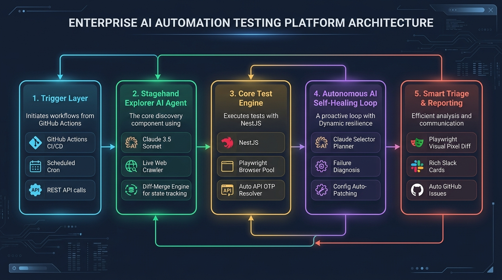
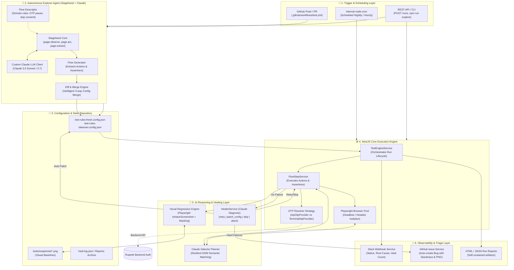
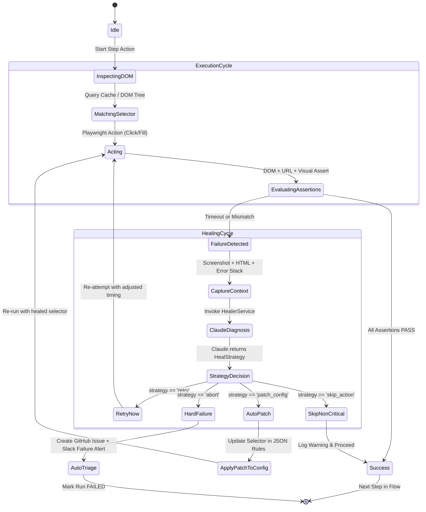
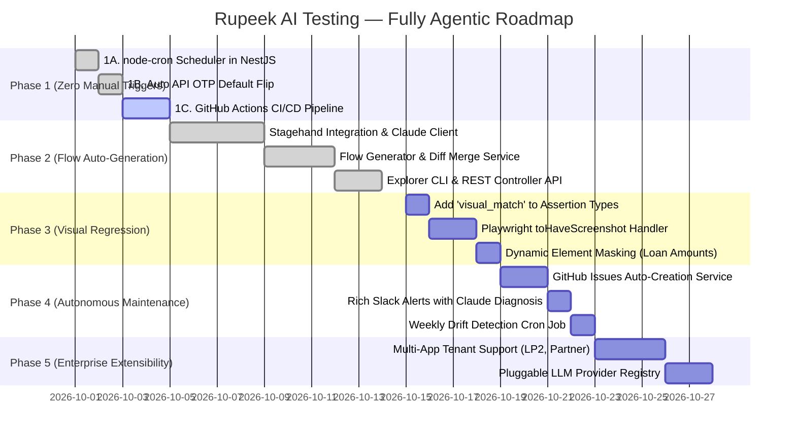

# Rupeek AI Testing — Fully Agentic Automation & Future System Design Plan 🚀
**Doc Version:** `2.0.0-PROD-AGENTIC`  
**Author:** Piyush Kumar & AI Engineering Team  
**System:** Autonomous AI-Driven QA & Self-Healing Testing Engine for Rupeek  
**Target Goal:** 0 Humans in routine QA loop (~85% manual effort reduction per sprint)  
**Language:** Hinglish (English Architecture + Hindi Conceptual Clarity)

---

## 📌 1. Executive Summary & Vision (Hum Kahan Hain Aur Kahan Jana Hai)

### 1.1 Where We Are Today (Current State Analysis)
Humara current AI testing system already conventional automation (Selenium, Cypress, brittle hardcoded Playwright scripts) se kafi aage hai. Hum Claude LLM ke through dynamic DOM selectors pick karte hain, assertions evaluate karte hain, aur failures aane par self-healing session run karte hain. 

Lekin aaj bhi **4 major manual interventions** system me human bottleneck ban rahe hain:

| Manual Step | Frequency | Kaun Karta Hai | Pain Point / Bottleneck |
|---|---|---|---|
| **1. Write JSON Flow Configs** | Har nayi feature ya UI change par | Software Engineer / QA | UI change hone par manually actions, selectors, assertions likhna padta hai. |
| **2. Trigger Test Runs** | Har deploy ya PR merge ke baad | QA / DevOps / Dev | Manually CLI run karna ya endpoint hit karna padta hai. |
| **3. Enter OTP in Auth Steps** | Har single test run me | QA / Developer | Terminal par wait karke manually OTP type karna padta hai. |
| **4. Review Heal Logs & Stuck Flows** | Jab Claude self-heal na kar paye | QA Lead | Failure ke baad Slack/terminal dekh kar issue dhundna padta hai. |

---

### 1.2 What "Fully Agentic" Means (Humara Ultimate Goal)
> **Fully Agentic ka matlab hai:** Routine testing cycles me **Zero Humans in the loop**.  
> Human ka involvement **sirf aur sirf tab hoga jab Rupeek product me koi real bug ho**, na ki test setup ya infrastructure tootne par!

```
[ Developer Pushes Code to GitHub ]
               │
               ▼
   [ GitHub Actions CI Workflow Triggered ]
               │
               ▼
   [ Stagehand Explorer Agent visits Web App ]
         (Detects UI Changes / New Screens)
               │
       ┌───────┴───────┐
       ▼               ▼
[ Drift Found ]    [ No Drift ]
Auto-updates        Skip config
JSON config &        update
commits to Git
       │               │
       └───────┬───────┘
               ▼
   [ Test Engine (NestJS) kicks off Run ]
               │
   [ Auto OTP fetched via Backend API ]  <-- (No human terminal prompt!)
               │
   [ Playwright + Claude Execution Loop ]
               │
       ┌───────┴───────┐
       ▼               ▼
 [ Step Passes ]   [ Step Fails ]
  Next Step              │
                   [ Claude Healer Diagnoses ]
                         │
                   ┌─────┴──────────────┐
                   ▼                    ▼
             [ Auto-Healed ]     [ Unrecoverable Bug ]
             (Patches config)           │
                                        ├─► Auto-create GitHub Issue
                                        └─► Slack Alert with Failure Video/PNG
               │
               ▼
   [ Visual Regression Diff (Playwright) ]
               │
   [ Slack: "All Clear" OR "Bug Triaged" ]
```

---

## 🏗️ 2. High-Level Design (HLD) Architecture

Humara system modular aur fully extensible micro-services/modular monolith pattern par based hai. Har component ek well-defined boundary ke andar rehta hai aur interfaces ke through interact karta hai.

### 2.1 High-Level Architecture Diagram (Visual Infographic)



### 2.2 Complete End-to-End System HLD Flowchart



---

## 🧩 3. Clean Architecture: Extensibility Pillars (Har Layer Ko Pluggable Banana)

Humare architecture ka core mantra hai: **Dependency Inversion Principle (DIP)**. Koi bhi core business logic directly external vendors (jaise sirf Anthropic ya sirf Slack) par hard-bound nahi honi chahiye.

```mermaid
classDiagram
    direction TB
    class ILLMClient {
        <<interface>>
        +createChatCompletion(options)
        +prioritizeActions(actions, objective)
        +diagnoseFailure(context)
    }
    class ClaudeLLMClient {
        -anthropicClient
        +createChatCompletion()
    }
    class OpenAILLMClient {
        -openAIClient
        +createChatCompletion()
    }
    class DeepSeekLLMClient {
        -client
        +createChatCompletion()
    }
    ILLMClient <|.. ClaudeLLMClient
    ILLMClient <|.. OpenAILLMClient
    ILLMClient <|.. DeepSeekLLMClient

    class IOtpProvider {
        <<interface>>
        +getOtp(mobile, context) Promise~string~
    }
    class ApiOtpProvider {
        -backendUrl
        +getOtp()
    }
    class TerminalOtpProvider {
        +getOtp()
    }
    class TwilioSmsOtpProvider {
        +getOtp()
    }
    IOtpProvider <|.. ApiOtpProvider
    IOtpProvider <|.. TerminalOtpProvider
    IOtpProvider <|.. TwilioSmsOtpProvider

    class INotificationSink {
        <<interface>>
        +notifyRunCompleted(result, reportUrl)
        +notifyFailure(failureContext)
    }
    class SlackNotificationSink {
        +notifyRunCompleted()
    }
    class TeamsNotificationSink {
        +notifyRunCompleted()
    }
    INotificationSink <|.. SlackNotificationSink
    INotificationSink <|.. TeamsNotificationSink

    class IIssueTracker {
        <<interface>>
        +createIssue(title, body, labels, attachments)
    }
    class GitHubIssueTracker {
        +createIssue()
    }
    class JiraIssueTracker {
        +createIssue()
    }
    IIssueTracker <|.. GitHubIssueTracker
    IIssueTracker <|.. JiraIssueTracker
```



### 3.1 Kyun Yeh Extensibility Rupeek ke liye Game-Changer Hai?
1. **Multi-LLM Resilience:** Agar Anthropic API down ho ya rate limit aaye, toh system effortlessly OpenAI (GPT-4o) ya self-hosted DeepSeek par failover kar sakta hai.
2. **Environment Agnostic OTP:** Staging me API se direct OTP aayega, local debug mode me terminal prompt khulega, aur agar integration test ho toh direct Redis cache ya mock service se instant mil jayega.
3. **Multi-Channel Alerting:** Engineering team Slack use karti hai, management JIRA dashboard dekhti hai, aur CI/CD pipeline GitHub Issues me automatic bug tracking chahta hai. Sab decoupled plugins hain!

---

## 🔄 4. Deep System Design Analysis & Execution Lifecycles

### 4.1 The Autonomous Self-Healing & Drift Lifecycle (Step-by-Step State Machine)



---

### 4.2 Explorer Agent Architecture (Stagehand + Claude Integration)

Phase 2 me humne Stagehand ko integrate kiya hai. Stagehand Playwright ke upar 3 core primitives deta hai:
1. `page.observe()`: Page ke saare interactable buttons, inputs, links ko scan karta hai aur natural language descriptions generate karta hai.
2. `page.act()`: Natural language prompt ko analyze karke actual element par click/fill karta hai without hardcoded XPath.
3. `page.extract()`: Zod schema ke through screen se structured data nikalta hai.

#### Humara Custom Flow Descriptor & Diff-Merge Innovation:
Har web exploration blind nahi ho sakti. Rupeek flows me **Domain Intelligence** chahiye hoti hai:
- Mobile number enter karne ke baad OTP screen aayegi -> Agent ko pata hona chahiye ki **Pause at OTP screen** (kyunki OTP enter karna testing flow ka kaam hai, explorer ka kaam sirf steps record karna hai).
- Consent checkboxes / terms & conditions ko handle karna.
- **3-Way Diff Merge:** Agar pehle se 5 steps existing config me hain, aur UI me sirf Step 2 change hua hai, toh explorer pure file ko overwrite nahi karega — `DiffMergeService` intelligently naye actions ko patch karta hai aur existing assertions retain karta hai!

---

## 📅 5. Complete Building Plan (Phase-by-Phase Roadmap)

Humne pure transformation ko **5 targeted phases** me divide kiya hai:



---

### 🟢 Phase 1: Zero Manual Triggers (Effort: ~2–3 Days)
**Goal:** Kisi human ko test run trigger karne ke liye terminal me command na type karni pade aur na hi OTP enter karna pade.

#### 1A. In-App Scheduling with `node-cron`
- `TestRules.schedule` me already cron string (jaise `"0 */6 * * *"`) define rehti hai.
- NestJS bootstrap time par har variant ke schedule ko read karke internal cron register karna.
- **Zero infra cost:** Kisi external Jenkins/CloudWatch ki zarurat nahi, NestJS app khud apna schedule manage karta hai.

#### 1B. Make API OTP Default
- `src/modules/otp/otp.module.ts` me default factory check ko update karna:
```typescript
// Proposed Enhancement in src/modules/otp/otp.module.ts
useFactory: (terminal: TerminalOtpProvider, api: ApiOtpProvider) => {
  const interactive = process.env.INTERACTIVE_OTP === 'true';
  return interactive ? terminal : api;
}
```
- CI/CD aur automated runs me `INTERACTIVE_OTP=false` rahega, jisse backend API se OTP instantly fetch ho jayega!

#### 1C. GitHub Actions CI/CD (`.github/workflows/test.yml`)
- Triggers: Push to `main`/`staging`, Pull Requests, aur nightly schedule.
- NestJS server boot hoga -> `/runs` API hit karega -> Test execution complete hone tak wait karega -> Results & HTML report artifact upload karega.

---

### 🟢 Phase 2: Flow Auto-Generation with Stagehand (COMPLETED ✅ & VERIFIED)
**Goal:** Kisi engineer ko haath se lambe JSON flow configs na likhne padein.
- **Stagehand 1.14.0** integrated with `@anthropic-ai/sdk`.
- `ClaudeLLMClient` conforms 100% to Stagehand's `LLMClient` contract.
- `ExplorerService` + `DiffMergeService` + `ExplorerController` (`POST /explorer/explore`) + CLI (`npm run explore -- --variant fresh`) fully functional.

---

### 🟡 Phase 3: Visual Regression Testing (Effort: ~2–3 Days)
**Goal:** Agar CSS change se layout shift ho jaye, button 10px khisak jaye, ya font/color corrupt ho jaye, toh system automatically pixel diff se catch kar sake.

#### 3A. Type Definition Update (`src/common/types/test.types.ts`)
```typescript
export type AssertionType =
  | 'url_contains'
  | 'element_visible'
  | 'text_matches'
  | 'no_error_toast'
  | 'visual_match'; // <-- Naya type add karenge

export interface TestAssertion {
  type: AssertionType;
  value?: string;
  label?: string;
  pattern?: string;
  maskSelectors?: string[]; // Dynamic elements (loan amounts, timestamps) ko mask karne ke liye
  maxDiffPixelRatio?: number; // Tolerance threshold (e.g. 0.02 = 2%)
}
```

#### 3B. Handler Implementation in `FlowStepService`
Playwright ka native `expect(page).toHaveScreenshot()` use hoga:
- Baseline PNG `tests/snapshots/<variant>/<step-name>.png` me store hoga.
- Dynamic data fields (jaise loan interest rate ya customer name) ko `maskSelectors` se black-box mask kar diya jayega taaki false positives na aayein!

---

### 🟡 Phase 4: Autonomous Maintenance & Reporting (Effort: ~3–4 Days)
**Goal:** Jab unrecoverable failure aaye, toh system khud GitHub Issue open kare aur rich context provide kare.

#### 4A. GitHub Issues Auto-Creator (`src/modules/notifications/github-issue.service.ts`)
- Agar test run fail hota hai aur Healer ka outcome `failed` hai:
  - System GitHub REST API ke through issue banayega:
    - **Title:** `[Bug][Automated QA] Failure in <SiteName> - Step: <StepName>`
    - **Labels:** `automated-test-failure`, `needs-triage`, `p1-bug`
    - **Body:** Claude ka Root Cause Diagnosis, failed step actions, exact selector info, aur attached failure screenshot.

#### 4B. Rich Slack Notification Upgrade
- Run results me:
  - Total steps, passed count, **self-healed count (Claude dwara recover kiye gaye)**, aur hard failures count.
  - Claude ka plain-English root cause summary.
  - Direct clickable link to generated HTML report.

#### 4C. Weekly Config Drift Detection Cron
- Har Monday subah 6:00 AM par explorer agent run hoga.
- Agar UI me drift mila, toh config update commit karega aur Slack par QA lead ko notification bhejega: *"3 screens updated in fresh loan flow. Please review auto-generated PR."*

---

### 🔵 Phase 5: Enterprise Extensibility & Multi-Tenant Support (Future-Proofing)
**Goal:** Rupeek ke multiple portals (Customer Web, Gold Loan Takeover, Partner Portal, Agent App) ko single platform se test karna.

```
                  ┌──────────────────────────────┐
                  │    Core AI Testing Engine    │
                  └──────────────┬───────────────┘
                                 │
     ┌───────────────────────────┼───────────────────────────┐
     ▼                           ▼                           ▼
[ B2C Web Portal ]     [ Partner/Agent Web ]        [ Mobile Web View ]
Base: rupeek.com       Base: partner.rupeek.com     Base: m.rupeek.com
Auth: Customer OTP     Auth: SSO / Agent ID         Auth: App Token / DeepLink
Config: fresh.json     Config: partner.json         Config: mweb.json
```

1. **Multi-App Workspace:** Config directory ko app-wise split karna: `config/apps/b2c-web/`, `config/apps/partner/`.
2. **Pluggable LLM Strategy:** Model switching via config:
   - High complex reasoning steps -> Claude 3.5/3.7 Sonnet
   - Simple DOM checks & data extraction -> Claude 3.5 Haiku (10x sasta & faster!)
3. **Prompt Caching & Cost Optimization:** Anthropic prompt caching use karke DOM snapshots par token costs 70% reduce karna.

---

## 🔒 6. Security, Masking & Secret Management

| Concern | Solution in Architecture |
|---|---|
| **Customer PII / Mobile / PAN** | Test configs me synthetic test credentials use honge. DOM logs aur HTML reports me PII fields automatically mask honge regex ke through (`XXXXXX1234`). |
| **API Keys (Anthropic / GitHub)** | Kabhi bhi git me commit nahi honge. `.env` file me local dev ke liye aur GitHub Secrets me CI/CD ke liye inject honge. |
| **OTP Expiry & Security** | `ApiOtpProvider` direct Rupeek staging internal backend auth service se short-lived mock/test OTP fetch karta hai with strict IP whitelisting. |

---

## ⚖️ 7. The Honest 10% — What Stays Manual (Kahan Human Chahiye Hi Chahiye)

Hum fully autonomous system bana rahe hain, lekin testing me 100% human-free hona impossible aur risky hota hai. Yeh table batata hai ki kya manual rahega aur **kyun yeh company ke liye best hai**:

| Situation | Kyun Automate Nahi Ho Sakta? | Human Action Needed |
|---|---|---|
| **1. Genuine Product Bug** | App sach me tut gaya hai (e.g. backend 500 ya calculation error). AI bug fix nahi kar sakta, sirf report kar sakta hai. | Rupeek Software Engineer code fix karega. |
| **2. Brand New First-Time Feature** | Nayi screen abhi deploy hi nahi hui ya wireframe stage me hai. Explorer wahi explore kar sakta hai jo live hai. | Deploy hone ke baad 1 baar `npm run explore` run karna. |
| **3. Visual Baseline Approval** | Agar designer ne jaan-bujhkar UI redesign kiya hai (e.g. naya color scheme), toh AI ko nahi pata yeh bug hai ya intentional feature. | QA Lead new screenshot ko review karke baseline approve karega (`--update-snapshots`). |
| **4. Healer Patch Verification** | Jab Claude `confidence: medium` ke sath selector patch karta hai, ek sanity check safe rehta hai. | Weekly heal-log me 5 minute ka spot-check. |

> **Bottom Line:** Pehle engineer test likhne aur run karne me **hafte ke 5–6 ghante** barbaad karta tha. Is system ke baad sirf **30 minute per week** spend honge — aur wo bhi sirf high-level decisions lene me!

---

## 🚀 8. Immediate Actionable Checklist for Developers

- [x] **Phase 2 Complete:** Stagehand Explorer + Claude LLM Client + Diff Merge Service build aur verify ho gaya.
- [ ] **Step 1:** `src/modules/otp/otp.module.ts` me `INTERACTIVE_OTP` logic update karo.
- [ ] **Step 2:** `src/main.ts` me `node-cron` wire karo jo `TestRules.schedule` se auto-trigger kare.
- [ ] **Step 3:** `.github/workflows/test.yml` create karo jo har push par NestJS + Playwright CI pipeline run kare.
- [ ] **Step 4:** `src/common/types/test.types.ts` aur `flow-step.service.ts` me `visual_match` assertion add karo.
- [ ] **Step 5:** `github-issue.service.ts` create karo jo unhealed failures par automatic GitHub issue open kare.
- [ ] **Step 6:** Slack notification ko rich card layout me upgrade karo with report link & heal metrics.

---
*Created with ❤️ for Rupeek AI Automation Engineering.*
